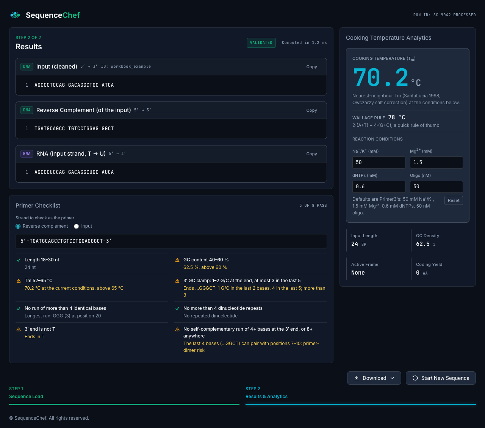
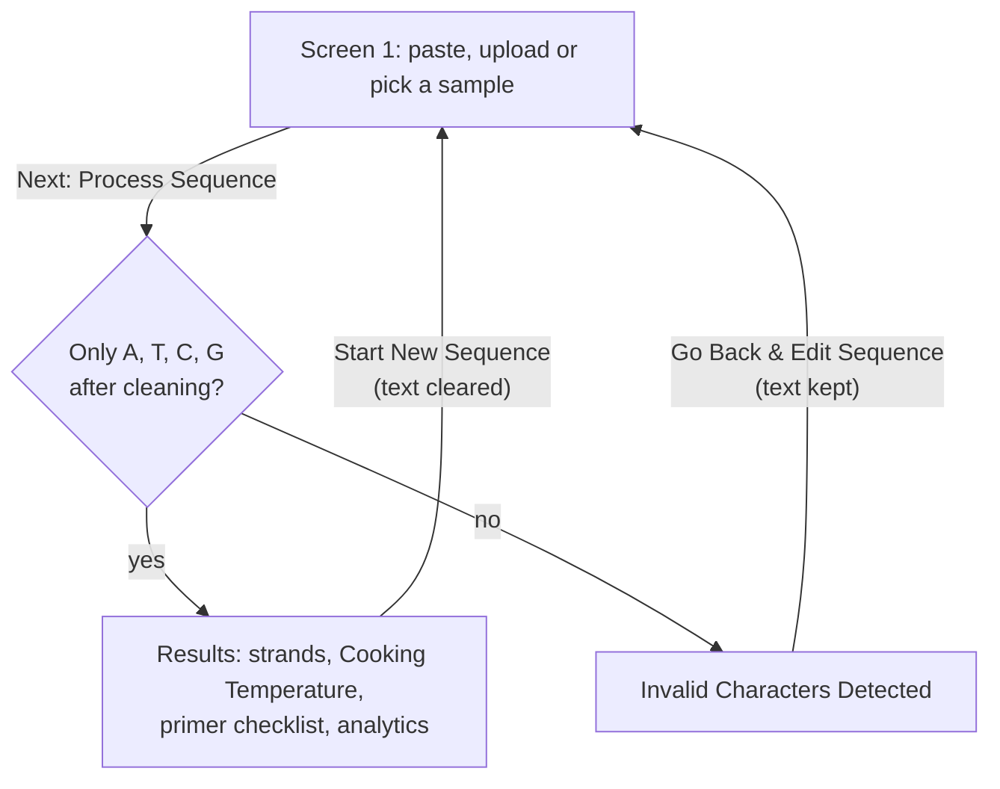
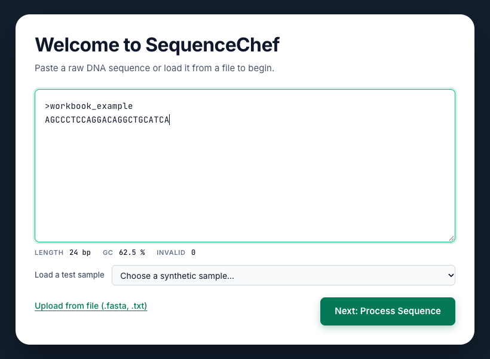
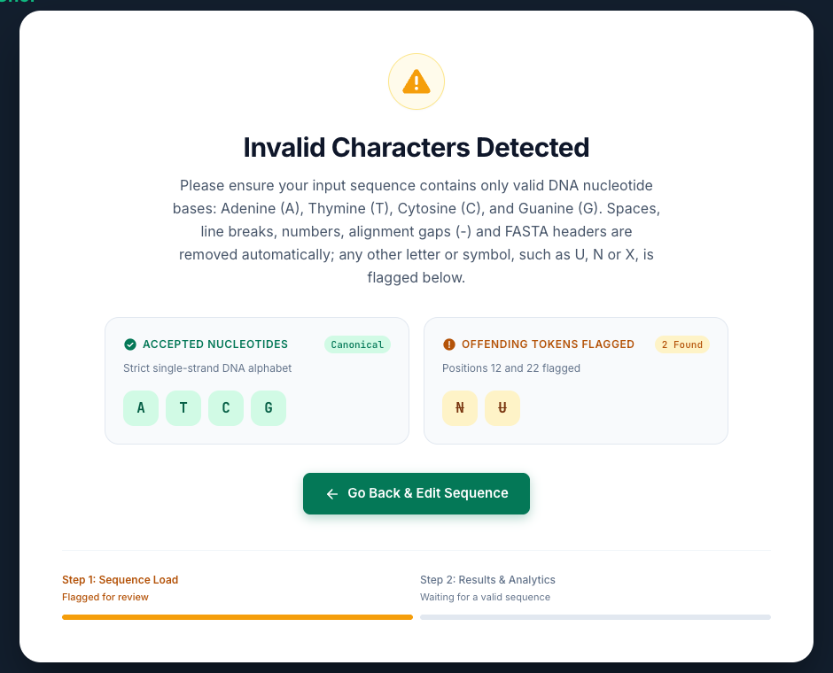

# SequenceChef

**Flip a DNA sequence and convert it to RNA in one click.** Paste a sequence and SequenceChef gives you its reverse complement (the partner strand, read 5′→3′) and its RNA transcript, ready to copy. When the sequence is a primer, it also gives you its melting temperature and a primer checklist.

SequenceChef runs entirely in the browser. There is no account, no server and no upload: the sequence never leaves your computer.



## Contents

- [Who it is for](#who-it-is-for)
- [Two ways to use it](#two-ways-to-use-it)
- [What it does](#what-it-does)
- [How to use it](#how-to-use-it)
- [How the numbers are calculated](#how-the-numbers-are-calculated)
- [Run it locally](#run-it-locally)
- [Project structure](#project-structure)
- [Privacy](#privacy)
- [Limitations](#limitations)
- [About this project](#about-this-project)
- [Roadmap](#roadmap)

## Who it is for

**Molecular biology and biotech students** who work with DNA sequences in courses and lab practicals, and the **lab technicians and researchers** they work with.

DNA is written with four letters, A, T, C and G. Its two strands pair letter by letter (A with T, C with G) and run in opposite directions, so the partner of a strand is found by swapping every letter and reading the result backwards. That is the **reverse complement**. When a cell copies DNA into RNA, T becomes U: that is **transcription**.

In exercises and in the lab, these two conversions come up all the time. By hand they mean swapping every base and reversing the order: slow, and one wrong letter gives a wrong answer, a wrong probe, or a wrong primer that is ordered, paid for and only fails later in the lab. Sequences copied from databases also come with header lines, position numbers and spaces that have to be removed first. SequenceChef does all of this in one click, without mistakes.

## Two ways to use it

Every result screen shows the same outputs. What you paste decides how you use them.

### 1. Convert a sequence: reverse complement and RNA

Paste any DNA sequence, from a database such as NCBI, an exercise or a sequencing result, and get:

- its **reverse complement**: the other strand, read 5′→3′. Use it, for example, to read a gene that sits on the opposite strand, to check a sequencing read made with a reverse primer, or to write the complementary strand in an exercise;
- its **RNA**: the pasted strand with every T replaced by U. When you paste the coding strand, which is what databases show, this is the sequence of the mRNA the cell makes.

This is the core of the app: one input box, cleaning and validation, both conversions, and a Copy button for each.

### 2. Check a primer: the reverse primer and its Cooking Temperature

PCR copies one region of DNA, starting from two short primers (18–30 bases) that bind at either end:

- the **forward primer** is the first bases of the region, exactly as written (5′→3′);
- the **reverse primer** is the **reverse complement of the last bases of the region** (the right-hand end).

To get the reverse primer, paste only those last 18–30 bases. The reverse complement on the results screen is the primer to order. Next to it you get:

- its **Cooking Temperature**: the melting temperature (Tm), the temperature at which the primer separates from the DNA it binds to. The PCR binding temperature is chosen from it;
- the **primer checklist**: length, GC content, Tm range, 3′ end, repeats and self-complementarity.

To check a forward primer instead, paste it and switch the checklist to **Input**.

The checklist only runs on sequences up to 60 nt. SequenceChef does not choose primers inside a long gene for you; you choose the region and paste its end.

## What it does

**Input**
- Paste a sequence, pick one of four synthetic test samples, or load a `.fasta`, `.fa`, `.fas` or `.txt` file.
- Cleans the text automatically: FASTA header lines (`>…`), spaces, line breaks, position numbers and alignment gaps (`-`) are removed, and lowercase is accepted.
- Shows the length, GC content and number of invalid characters live while you type.
- Stops before merging two FASTA records into one sequence by mistake, and offers to keep only the first record.

**Validation**
- Accepts only A, T, C and G. Anything else (U, N, X…) opens a warning screen that lists each invalid character and its positions. One click takes you back with your text intact.

**Results**
- The cleaned input, its **reverse complement** and its **RNA transcript**, all written 5′→3′, with numbered rows in groups of 10 bases and a Copy button each.
- **Cooking Temperature**: the melting temperature (Tm), calculated with the nearest-neighbour model that commercial primer tools use. You can set the salt, Mg²⁺, dNTP and primer concentrations. The quick Wallace rule is shown next to it for comparison.
- **Primer checklist**: eight pass/warning checks on length, GC content, Tm, the 3′ end, repeats and self-complementarity, each with a short reason.
- **Analytics**: length, GC content, and the longest protein-coding stretch (open reading frame) across all six reading frames.
- **Download** the three strands as FASTA, plain text or CSV, or everything, including the metrics and the Tm, as JSON. Files are named after the FASTA ID.

## How to use it



### 1. Enter a sequence



Use one of these:

- **Paste** the sequence into the text box. You can paste it straight from a database: a record such as

  ```
  >Human_Ins
   1 AT-CG 20 tagc
  ```

  is read as `ATCGTAGC`.
- **Load a test sample** from the drop-down: four synthetic sequences from 717 to 1,606 bp.
- **Upload from file**: `.fasta`, `.fa`, `.fas` or `.txt`, up to 1 MB. The file's text goes into the box so you can check it first.

The line under the box updates as you type: length, GC % and the number of invalid characters, with the first few listed. It pauses for very long inputs (over 200,000 characters).

If the text contains **more than one FASTA record**, a notice appears and the app will not continue until you remove the extra records or click **Keep first record only**. SequenceChef works on one sequence at a time.

### 2. Click "Next: Process Sequence"

- If the cleaned sequence contains only A, T, C and G, the results open.
- If it contains anything else, the **Invalid Characters Detected** screen opens. It lists each offending character and where it is (positions are counted in the cleaned sequence). **Go Back & Edit Sequence** returns to Screen 1 with your text exactly as you left it.



### 3. Read the results

- **Strands.** *Input (cleaned)* shows exactly what was processed, with the FASTA ID if the input had one. *Reverse Complement (of the input)* is the partner strand. *RNA (input strand, T → U)* is the transcript. Long sequences scroll inside their box, so the buttons below stay in reach. **Copy** copies the plain sequence, without the row numbers or spaces.
- **Cooking Temperature.** The big number is the Tm at the reaction conditions listed below it. Change Na⁺/K⁺, Mg²⁺, dNTPs or the primer (oligo) concentration to match your PCR mix, and the Tm and the checklist update at once. **Reset** restores the defaults.
- **Primer Checklist.** Choose which strand you are ordering as the primer: the reverse complement (the default) or the input. Each row shows ✓ or ⚠ and the reason. The checks run on sequences up to 60 nt; for longer ones the panel just notes that the checklist applies to primers.
- **Analytics.** *Input Length* and *GC Density* describe the sequence. *Active Frame* is the reading frame with the longest open reading frame (ATG to a stop codon): +1 to +3 on the input (Sense), −1 to −3 on the reverse complement (Antisense). *Coding Yield* is that frame's length in amino acids.

### 4. Save and start again

- **Download** saves the input, reverse complement and RNA as FASTA, plain text or CSV. JSON adds the length, GC %, reading frame and the Tm, with the method and the conditions you set. Files are named after the FASTA ID, for example `Human_Ins-results.fasta`.
- **Start New Sequence** clears the saved input and returns to an empty Screen 1.

### Worked example

Input: the first 24 bases of the human insulin mRNA (NCBI NM_000207.3), `AGCCCTCCAGGACAGGCTGCATCA`, with the default conditions:

| Output | Value |
|---|---|
| Reverse complement | `TGATGCAGCCTGTCCTGGAGGGCT` |
| RNA of the input strand | `AGCCCUCCAGGACAGGCUGCAUCA`, the start of the insulin mRNA |
| Length / GC | 24 bp / 62.5 % |
| Cooking Temperature | 70.2 °C (nearest-neighbour); Wallace rule 78 °C |
| Primer checklist (on the reverse complement) | 3 of 8 pass. It warns about GC above 60 %, Tm above 65 °C, too many G/C in the last 5 bases, a 3′ T and possible primer-dimer at the 3′ end |
| Active frame | None (no ATG…stop in any frame) |

## How the numbers are calculated

All calculations are pure functions in [`src/calc.js`](src/calc.js), with no access to the page.

### Cleaning and validation

1. Lines that start with `>` (FASTA headers) are dropped.
2. Spaces, tabs, line breaks, digits and `-` are removed.
3. The rest is converted to uppercase.
4. The result must match `^[ATCG]+$`. Anything else is reported with its positions.

### Reverse complement and RNA

- **Reverse complement**: swap A↔T and C↔G, then reverse.
- **RNA**: the input strand with every T replaced by U.

### Cooking Temperature (Tm)

| Length | Method shown |
|---|---|
| up to 60 nt | **Nearest-neighbour** Tm: SantaLucia (1998) unified parameters with the Owczarzy (2004, 2008) salt correction for monovalent ions and Mg²⁺. dNTPs bind Mg²⁺, so only the free Mg²⁺ (Mg²⁺ − dNTPs) counts. These are the same equations Primer3 uses with its Owczarzy option. |
| over 60 nt | **Long-duplex estimate**: 81.5 + 16.6·log₁₀[Na⁺] + 0.41·(%GC) − 600/N, with Mg²⁺ converted to an equivalent Na⁺ (von Ahsen et al., 2001). It is labelled "not a primer Tm", because it describes a whole long DNA duplex. |
| up to 30 nt, as a reference | **Wallace rule**: 2·(A+T) + 4·(G+C). A quick rule of thumb. It is hidden above 30 nt, where it overestimates badly. |

The default conditions are Primer3's: 50 mM Na⁺/K⁺, 1.5 mM Mg²⁺, 0.6 mM dNTPs and 50 nM primer. Mg²⁺ raises the Tm. To compare with a calculator that only uses sodium, set Mg²⁺ to 0.

### Primer checklist

| Check | Passes when |
|---|---|
| Length | 18–30 nt |
| GC content | 40–60 % |
| Tm | 52–65 °C at the current conditions |
| 3′ GC clamp | at least 1 G/C in the last 2 bases, and no more than 3 G/C in the last 5 |
| Runs | no more than 4 identical bases in a row |
| Dinucleotide repeats | no more than 4 repeats (such as `ATATATAT`) |
| 3′ end | not T |
| Self-complementarity | no complementary run of 4+ bases involving the 3′ end, and none of 8+ anywhere |

The thresholds follow common vendor and Primer3 guidance. They flag likely problems; they do not replace a full secondary-structure (ΔG) analysis.

### Reading frame

The app searches all six reading frames (three on each strand) for the longest stretch that starts with ATG and ends at a stop codon, using the standard genetic code.

## Run it locally

You need [Node.js](https://nodejs.org/) 20.19 or later (or 22.12 or later).

```bash
npm install       # install Vite, the only (development) dependency
npm run dev       # start the development server, usually at http://localhost:5173
npm run build     # build the static site into dist/
npm run preview   # serve the built site locally
```

The build in `dist/` is plain static files, so any static host can serve it. Serve it from the site root, because the pages link to each other with paths that start with `/`. Copy to clipboard needs HTTPS (or `localhost`).

## Project structure

```
index.html            Screen 1: input, samples, file upload, live validation
results.html          Results: strands, Cooking Temperature, checklist, analytics
invalid.html          Invalid Characters Detected warning screen
src/calc.js           All calculations: cleaning, validation, strands, Tm, checklist, reading frames
src/init.js           Screen 1 behaviour
src/main.js           Results page: rendering, copy, download, start over
src/temperature.js    Cooking Temperature card and primer checklist panel
src/strand-view.js    Numbered, 10-base-grouped strand display for long sequences
src/export.js         FASTA, TXT, CSV and JSON export
src/invalid.js        Warning screen
src/storage.js        Hands the input from page to page (sessionStorage)
src/mock-data.js      The four synthetic test samples
src/*.css             Styles
design/               UI design references for each screen
vite.config.js        Lists the three pages for the build
```

The app is written in plain HTML, CSS and JavaScript, with no frameworks or runtime libraries. Vite is only used for the development server and the build.

## Privacy

Everything runs in your browser. The text you enter is kept in the tab's `sessionStorage`, only to pass it from one screen to the next. It is deleted when you click **Start New Sequence** or close the tab. No sequence is ever sent over the network. The only external request is for the Google Fonts used in the interface.

## Limitations

- One sequence at a time. With a multi-record FASTA, only the first record can be used.
- Only A, T, C and G are accepted. Ambiguity codes (N, R, Y…) and RNA input (U) are rejected, not interpreted.
- Inputs are limited to 1,000,000 characters (and files to 1 MB), so that they fit in browser storage.
- The Tm has no corrections for mismatches, DMSO or formamide. The checklist uses rules of thumb; it does not compute hairpin or dimer energies, does not check primer pairs, and does not check where else in a genome a primer could bind.
- The "Run ID" in the results header is a fixed label.
- Tested mainly in Chrome on desktop and phone-sized screens. There is no automated test suite yet.

## About this project

I built SequenceChef as my MVP for course module M2-05, *From an idea to an MVP*, from the brief "Reverse complement + DNA → RNA: flip a sequence and convert it to RNA". The MVP sheet in my workbook defines it like this:

| | |
|---|---|
| **We are building…** | a one-click web tool that flips a DNA sequence (reverse complement) and converts it to RNA… |
| **…for…** | molecular biology students, and the lab technicians and researchers they work with. |
| **Main workflow** | Paste a sequence → the app cleans and checks it → Process → copy the reverse complement and the RNA. |
| **Must-have** | One input box with one button; automatic cleaning and validation that shows which characters are wrong; reverse complement and DNA → RNA in one click, labelled 5′→3′; a Copy button for each result. |
| **Nice-to-have** | Cooking Temperature (Tm), the twist; live length and GC %; download as `.fasta` or `.txt`. |
| **Deliberately not built** | Protein translation, automatic primer design, genome (BLAST) search, user accounts or saved history, batch processing of many sequences. |

All must-haves and nice-to-haves are in the app. A few things go further than the sheet, or differ from my first draft:

- **Tm method.** My first pitch named the Wallace rule. Wallace is only meant for very short oligos: for the 24-nt example it gives 78 °C against 70.2 °C from the nearest-neighbour model, and for long sequences it gives impossible values. So the main number uses the nearest-neighbour model and Wallace stays visible as a reference.
- **Primer checklist and editable conditions** were added on top of the Tm, because they answer the question a primer user asks next: will this primer work?
- **RNA** is transcribed from the pasted strand, as in the workbook example, and every strand is labelled with where it comes from.
- **The main button** says "Next: Process Sequence" rather than "Cook Sequence", to match the two-step flow in the UI design.
- **The file uploader** is a simple version (it only loads the file's text into the box), and the **reading-frame metric** only reports the longest open reading frame. Neither translates the sequence into protein.

## Roadmap

- Primer pair mode: forward and reverse primers together, with the Tm difference, cross-dimer check and a suggested annealing temperature.
- Accept ambiguity codes (IUPAC) and report the Tm as a range.
- Colour-coded bases, a base-composition bar and a GC chart along the sequence.
- Molecular weight and extinction coefficient, for resuspending ordered primers.
- Unit tests for `src/calc.js`, and a public HTTPS deployment.
