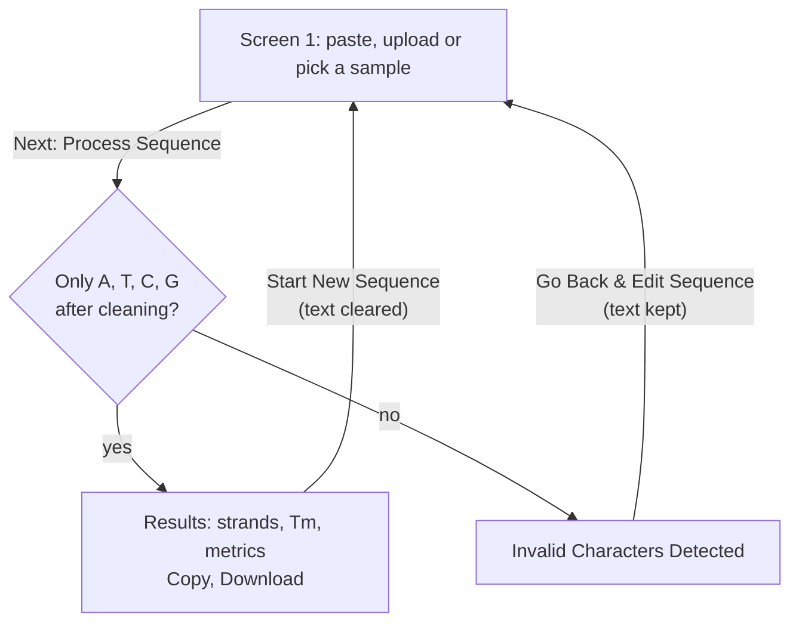
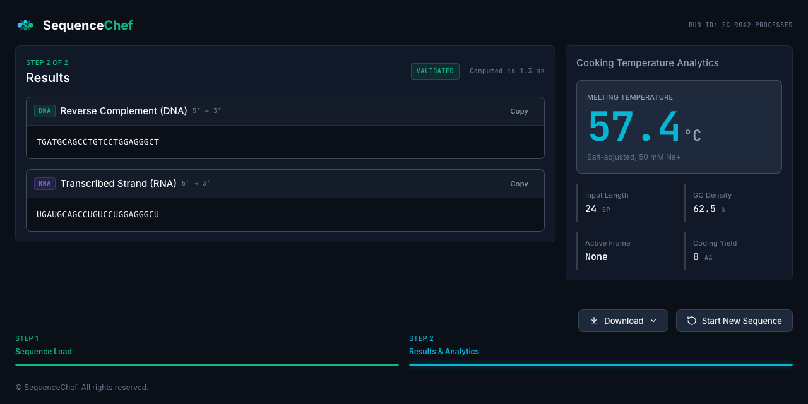
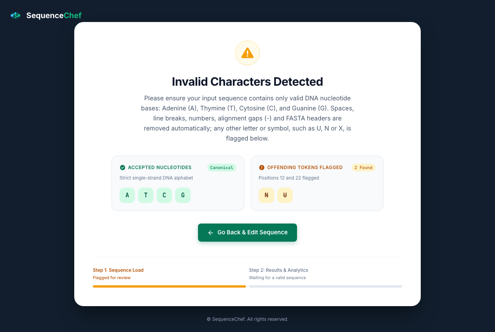

# SequenceChef: MVP brief

<!-- Author: add your name here. -->

**SequenceChef is a browser-only tool that checks a pasted DNA sequence and returns its reverse complement, RNA transcript and estimated melting temperature in one step, for researchers preparing PCR primers.**

Course module M2-05, *From an idea to an MVP*. Describes `main` plus the open pull requests #3 and #4 (see [Status](#7-current-status-and-known-limitations)).

## 1. Problem

DNA is written with four letters (A, T, C, G). Its two strands pair letter by letter (A with T, C with G) and run in opposite directions, so the partner strand is obtained by swapping every letter and reversing the result: the **reverse complement**. Cells copy DNA into RNA, which uses U instead of T: **transcription**.

Many researchers still do these conversions by hand. A 24-letter sequence means 24 swaps plus a reversal, and one slip can produce a wrong primer that is ordered and paid for, and only fails later in the lab. Sequences copied from databases also carry headers, line numbers and spaces that must be removed first.

## 2. Target users and main use case

- **Users:** wet-lab molecular biologists and biotech students, in academic labs and biotech R&D teams.
- **Main use case: preparing sequences for PCR primer design.** PCR copies one DNA region millions of times, starting from two short synthetic DNA pieces (primers) that bind at either end; one primer is the reverse complement of the region's far end.

Workbook example: `AGCCCTCCAGGACAGGCTGCATCA` → reverse complement `TGATGCAGCCTGTCCTGGAGGGCT`, which the app reproduces exactly.

## 3. Solution and the twist

Paste a sequence (or load a file), click once, and get both strands with **Copy** and **Download** actions and an analytics panel.

**The twist: Cooking Temperature Analytics.** The melting temperature (Tm) is the temperature at which half of a double-stranded DNA separates; the PCR temperature at which primers bind is chosen from it. Showing Tm next to the sequence saves a second tool. The result names the formula used:

| Length | Formula |
|---|---|
| under 14 nt | Wallace rule: 2·(A+T) + 4·(G+C) |
| 14 nt or more | Salt-adjusted: 81.5 + 16.6·log₁₀[Na⁺] + 0.41·(%GC) − 675/N, with Na⁺ = 50 mM |

## 4. MVP scope

| Feature | Workbook | Status |
|---|---|---|
| Text box and one start button | Must-have | Done |
| Clean and validate input | Must-have | In review (PRs #3, #4): strips FASTA headers, whitespace, digits and gaps (`-`), then accepts only A, T, C, G |
| Reverse complement and RNA | Must-have | Done |
| Copy buttons for both strands | Must-have | Done |
| Tm calculator (the twist) | Must-have | Done |
| Length and GC-content panel | Nice-to-have | Done, on the results page |
| Export | Nice-to-have | Done: FASTA, TXT, CSV, JSON |
| File uploader | Remove | Simple version: `.fasta`, `.fa`, `.txt` into the text box |
| Protein translation | Remove | Not built; a reading-frame metric shows the longest protein-coding stretch, in amino acids |
| Test sample picker | not listed | Added: four synthetic sequences, 717–1,606 bp |

Out of scope: accounts, a server or database, saved history, primer picking, batch processing.

## 5. Main workflow

Invalid input lands on a warning screen that lists each offending character and its positions (below: N and U at positions 12 and 22). Input that is empty after cleaning gets a "No DNA Sequence Found" variant.

  
  

## 6. How it is built

- **Vanilla HTML, CSS and JavaScript**, no frameworks or runtime libraries. Vite (a dev dependency) runs the dev server and the build. Three pages: `index.html`, `results.html`, `invalid.html`.
- **Pure calculation module:** `src/calc.js` has no DOM access; page scripts only display.
- **Browser-only:** no backend. The raw text passes between pages in `sessionStorage`, is cleared by "Start New Sequence" and is gone when the tab closes. The sequence is never sent over the network; the only external requests are for Google Fonts.
- **Measured speed:** the results page times the calculation alone. In headless Chrome on macOS it showed 0.5–1.5 ms for the workbook example and 0.7–1.8 ms for the 717–1,606 bp samples.

Run: `npm install`, then `npm run dev` or `npm run build`.

## 7. Current status and known limitations

**Status.** PRs #3 (sanitization) and #4 (strict validation and the warning screen) are open at the time of writing. Without them, invalid input shows an inline error on the results page, and digits or gaps are not stripped.

**Differences from the workbook**

- RNA is transcribed from the reverse complement (`UGAUGCAGCCUGUCCUGGAGGGCU` for the example), not from the input strand (`AGCCCUCCAGGACAGGCUGCAUCA`).
- The pitch names only the Wallace rule; the app uses it below 14 nt. The 24-nt example shows 57.4 °C, where Wallace would give 78 °C.
- The button reads "Next: Process Sequence", not "Cook Sequence".
- The uploader and the reading-frame metric exist despite "Remove", because the UI design in `design/` included them.
- Validation runs on Next, not live while typing.

**Limitations**

- Tm is computed for the whole input with no primer-concentration or Mg²⁺ correction; for a full gene it is not a primer Tm.
- Ambiguity letters (such as N, "any base") and RNA input (U) are rejected, not handled.
- A FASTA file with several records is joined into one sequence.
- The results header shows a static "Run ID" from the mockup.
- No automated tests yet.

## 8. Next steps

1. Review and merge PRs #3 and #4.
2. Decide which strand the RNA comes from, label it on screen, and align workbook and code.
3. Describe both Tm formulas in the pitch, and warn when the input is far longer than a primer.
4. Add unit tests for the pure functions in `src/calc.js`.
5. Publish over HTTPS (the clipboard API needs it outside localhost) and replace the static Run ID.
